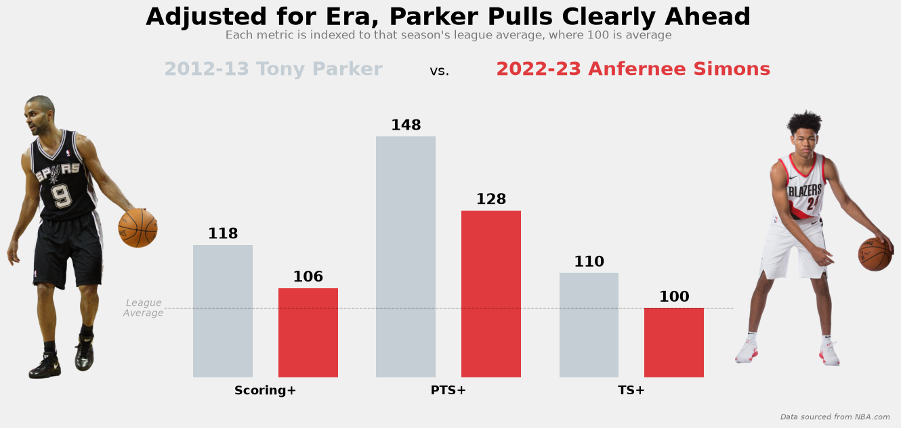

<h1 align="center">Baseline</h1>

<p align="center"><em>Era-adjusted NBA statistics, built so a scoring season from 2005 and one from 2025 can be compared on the same scale.</em></p>

<p align="center"><a href="https://baselineanalytics.streamlit.app/"><strong>Open the live app</strong></a></p>

## Why this project exists

NBA offense has changed a lot in the past decade. Since 2000-01, league points per game has risen about 22% and offensive rating about 13%. In 2012-13, only 11 players averaged 20+ points per game (minimum 1,500 minutes). By 2022-23, 52 did. That makes raw numbers from different seasons hard to compare.

Baseball solved this problem long ago with stats like ERA+ and OPS+, which index a player to his league's average so that **100 always means league average**. Baseline brings that idea to basketball, with new player and team statistics built from existing box score and advanced data, plus a Streamlit web app to explore them.



Tony Parker (2012-13) and Anfernee Simons (2022-23) put up nearly identical raw scoring numbers. Once each season is measured against its own league, Parker posts a Scoring+ of 118 (6th in the league) and Simons a 106 (73rd).

## The statistics

### Scoring+ (players)

A single number summarizing how effective a player's scoring was relative to his league, combining volume and efficiency:

$$
\text{Scoring}^{+} = 100 + 0.205\,(\text{PTS}^{+} - 100) + 0.795\,(\text{TS}^{+} - 100)
$$

- **PTS+**: points per 100 possessions vs. the league-average player (scoring volume)
- **TS+**: true shooting percentage vs. the league average (scoring efficiency)

The 0.205 / 0.795 weights are not assumed. They come from regressing PTS+ and TS+ against offensive impact metrics (OBPM and OWS/48), validated with a time-based train/test split and 5-fold cross-validation, and checked for stability across seasons. Players need at least 1,500 minutes to qualify.

Full write-up: [Scoring+ Methodology](docs/scoring_plus_methodology.md)

### oRating+ (teams)

A team's offensive rating indexed to the league average of its season:

$$
\text{oRating}^{+} = \frac{\text{Team Offensive Rating}}{\text{League Average Offensive Rating}} \times 100
$$

It breaks down into two components:

- **TS+**: team shooting efficiency vs. the league
- **Possession+**: how much better or worse an offense scored than its shooting alone would predict, estimated from a pooled regression of oRating+ on TS+. It mostly reflects offensive rebounding and turnover avoidance, which together explain about 95% of its variance

The write-up also tests whether the 2000s offenses that top the all-time oRating+ list are real outliers or a quirk of the formula (they hold up, including under a z-score adjustment).

Full write-up: [oRating+ Methodology](docs/o_rating_plus_methodology.md)

## The app

The Streamlit app, **[Baseline](https://baselineanalytics.streamlit.app/)**, has pages for:

- **Players**: season leaderboards for Scoring+, PTS+, TS+ and traditional stats, filterable by season and scoring-title qualification
- **Player Breakdown**: a single player's seasons and career averages
- **Teams** and **Team Breakdown**: oRating+ and its components for every team-season
- **Compare**: side-by-side player or team comparisons
- **Customized Analysis**: chart any two stats against each other for players or teams, across any set of seasons
- **About**: both methodology write-ups

## Data

- Seasons 2000-01 through the current season, **updated automatically every morning** during the regular season
- Player and team season data from [Basketball-Reference](https://www.basketball-reference.com/) via [`basketball_reference_web_scraper`](https://github.com/jaebradley/basketball_reference_web_scraper)
- Per-100-possession, scoring split and team advanced stats from NBA.com via [`nba_api`](https://github.com/swar/nba_api)
- Everything is stored in a SQLite database, with a mapping step that links Basketball-Reference and NBA.com player IDs

### Daily updates

A [GitHub Actions workflow](.github/workflows/daily-update.yml) runs every morning from October through April:

1. Downloads the full database (`nba_stats.db`, every raw and derived table) from the repo's `data-latest` release
2. Scrapes the current season from Basketball-Reference and NBA.com, replacing only that season's rows
3. Rebuilds the league averages, Scoring+, oRating+ and the app tables, stopping if any step fails or a season goes missing
4. Uploads the updated full database back to the release and commits the small `data/app.db` the app reads, which triggers a redeploy on Streamlit Cloud

The full database lives on a release rather than in git so that daily updates don't bloat the repo's history.

## Project structure

```
baseline_app.py         Streamlit app
run_pipeline.py         runs the whole data pipeline in order
data/                   app.db (tables the app reads) and team colors
pipeline/
  collect/              scrapers that pull raw data into the database
  transform/            scripts that build league averages, profiles and career tables
  metrics/              Scoring+ and oRating+ calculations
  export_app_db.py      copies the app's tables into data/app.db
  common.py             shared paths and season helpers
.github/workflows/      the daily update job
notebooks/              exploratory and methodology analysis
docs/                   methodology write-ups and their charts
```

## Running it locally

Requires Python 3.14.

```bash
pip install -r requirements.txt
streamlit run baseline_app.py
```

`data/app.db` is included in the repo, so the app runs without scraping anything.

### Running the pipeline

`run_pipeline.py` runs every step in order and stops at the first failure. It needs the full database, which you can download from the release with the [GitHub CLI](https://cli.github.com/):

```bash
gh release download data-latest --pattern nba_stats.db --dir data --clobber
```

Then:

```bash
python run_pipeline.py                  # update the current season (what the daily job runs)
python run_pipeline.py --season 2026    # refresh a specific season, by end year
python run_pipeline.py --all            # rebuild every season from scratch (slow: requests are rate limited)
python run_pipeline.py --skip-collect   # no scraping, just recompute from the existing database
```

## Tools

Python, pandas, NumPy, SQLite, statsmodels, scikit-learn, SciPy, Plotly, Matplotlib, seaborn, Streamlit, Jupyter

## Author

Thomas McEwen
