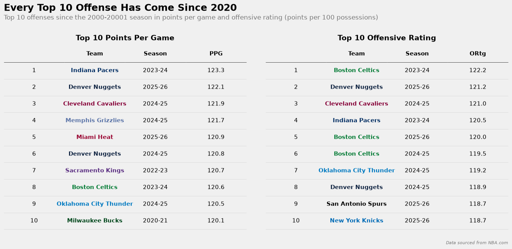
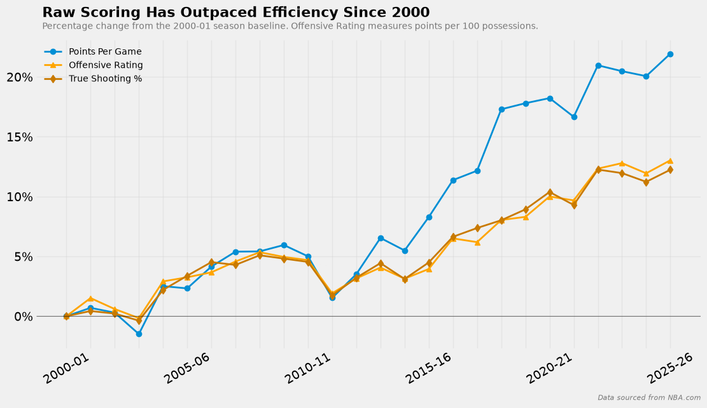
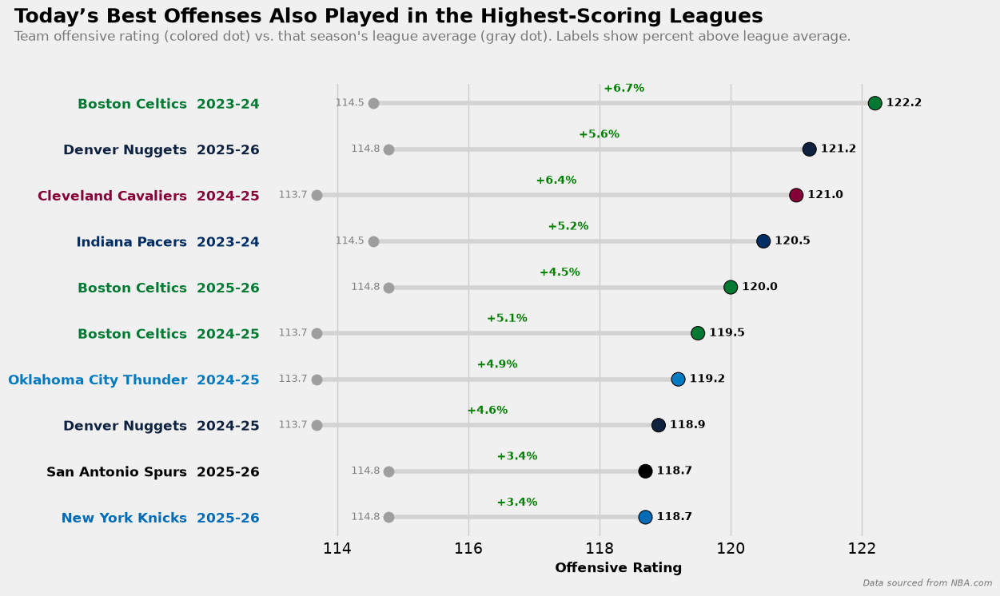
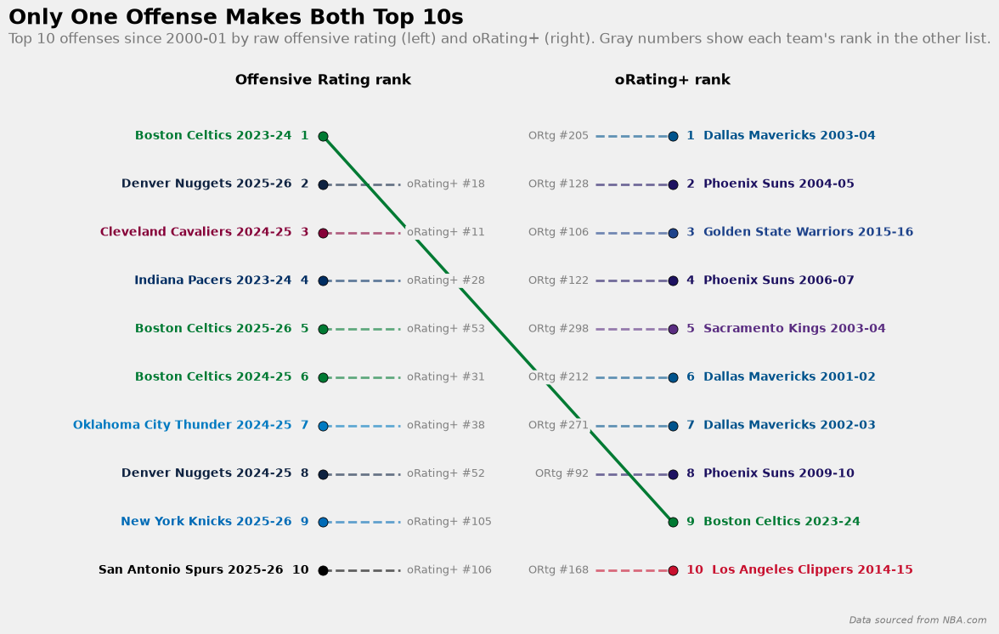
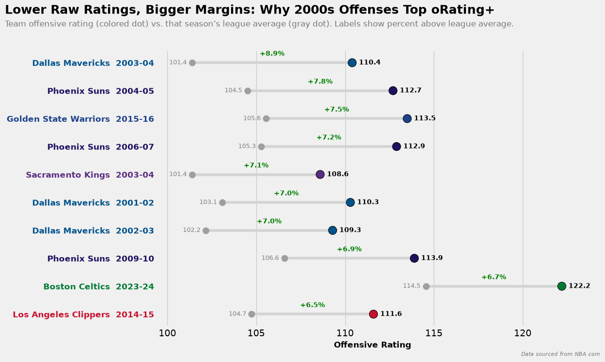
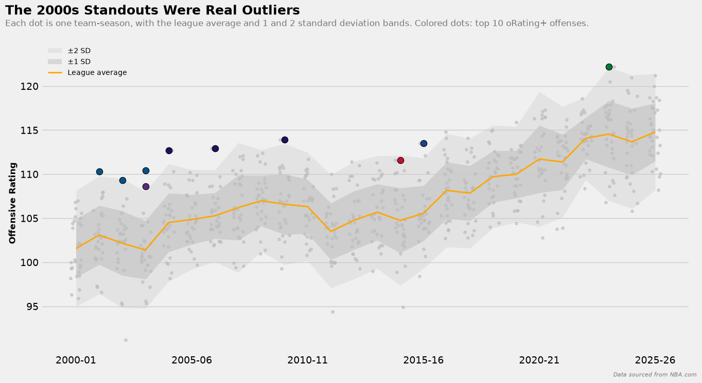
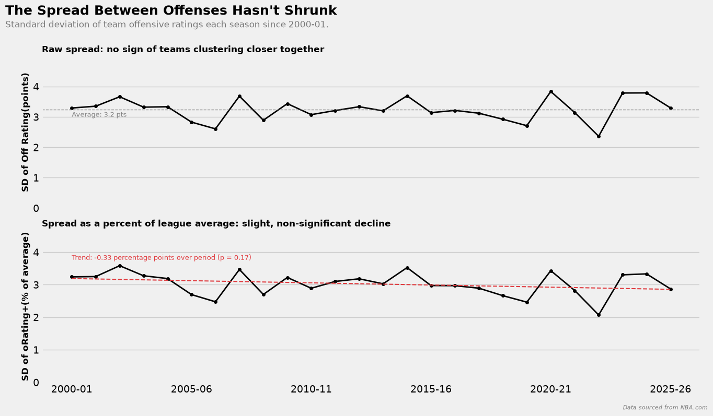
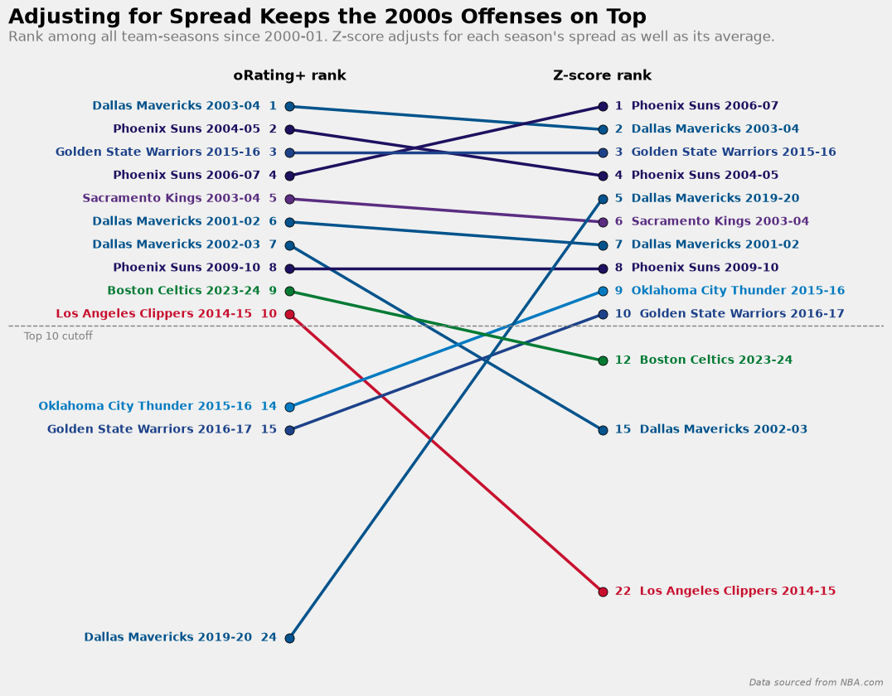

# oRating+ Methodology

## Introduction

After building Scoring+ to compare players' scoring across eras on a season-by-season basis, I wanted to take a similar approach and apply it to an entire team's offense. The same problems that fans run into with player scoring numbers applies just as much to a team's scoring. Offensive numbers today are so much higher than they were even a decade ago that comparing a modern offense to one from the 2000s or early 2010s using conventional statistics is very difficult.

The clearest sign of this scoring inflation is the record book. Every one of the top 10 offenses since 2000-01, whether you rank them by pure points per game or offensive rating (points per 100 possessions), has come since 2020, and the vast majority just in the past three seasons.

On paper, these are the best offenses of the century, and statistically that is true, they did put up the best numbers and score the most points. But as covered in the Scoring+ methodology, the league average has been rising right alongside them. Since 2000-01, league points per game has risen about 22% and offensive rating about 13%. A great offense in today is being measured against a much higher bar than a great offense was 10 or 20 years ago.

When you put each of these offenses next to the league average of the season they played in, the gap between them and their league is smaller than their raw ratings may suggest. The 2023-24 Celtics, the team with the highest offensive rating since 2000-01, recorded a 122.2 but the league average offensive rating that season was 114.5, one of the three highest averages in the same era. The Knicks and Spurs of 2025-26 each finished just 3.4% above the league average of their season.

To try to accomplish the same thing that Scoring+ is meant to do, give context to scoring numbers based on the environment they were produced in, I've created oRating+, a team counterpart.

## What is oRating+ and How Does It Differ From Scoring+?

oRating+ is built in the same statistical style as Scoring+ in that it also follows the formula of those baseball statistics I mentioned like ERA+ and OPS+. It is indexed so that 100 always represents the league average for a given season, so just as a player with a Scoring+ of 100 would be a league-average scorer, a team with an oRating+ of 100 would be a league-average offense. A team with an oRating+ of 105 scored 5% more efficiently than the league average that season and a team with a 95 scored 5% less efficiently.

**The Formula:**

$$
\text{oRating+} = \frac{\text{Team Offensive Rating}}{\text{League Average Offensive Rating}} \times 100
$$

Unlike Scoring+, oRating+ doesn't need a weighted formula to be computed. Scoring+ has to combine volume and efficiency because no single player stat captures both and different players play different roles in an offense, but for teams offensive rating already does that job. It measures points per 100 possessions, controlling for pace and reflects how well an offense turns its possessions into points, which is the team-level version of what Scoring+ is meant to measure for a player. There are much less complications when it comes to measuring an entire offense because team-level stats are all standardized as teams play the same amount of games and minutes and you don't have to account for outliers due to a smaller sample size. All that's left is to put it in the context of its league, so oRating+ simply indexes each team's offensive rating to the league average of its season.

Once you make that adjustment, the list of the best offenses changes pretty dramatically. Only one team, the 2023-24 Celtics, appears in the top 10s of both raw offensive rating and oRating+. Many of the teams with the highest offensive ratings drop considerably down the list for oRating+, including the 2025-26 Knicks and Spurs who drop from the top 10 into the 100s. In their place, the top of the oRating+ charts are dominated by teams from the 2000s, led by the 2003-04 Mavericks and the 2004-05 Suns.

Now you may be asking yourself, are those 2000s teams really that much better or is there something else behind that? Why those 2000s teams rise to the top, and whether it reflects real dominance or a quirk of the formula, is covered in a later section.

### Breaking down oRating+

While oRating+ itself is a single index, it can be broken down into two components that explain where and offense's success comes from:

- **TS+.** This is how much of the offense's success comes from shooting efficiency. This is also the same stat used in Scoring+, applied to the whole team.
- **Possession+.** This is how much of the offense's success comes from generating extra scoring opportunities, through offensive rebounding and avoiding turnovers.

These components aren't inputs to the oRating+ formula but instead they describe what's driving the output. Two teams can post the same oRating+ in very different ways: one by making shots at an elite rate and the other by winning the possession battle with offensive rebounds and preventing turnovers.

## TS+

This is the same statistic used in Scoring+, applied to a whole team and its offense instead of a single player. It captures the shooting efficiency of an offense by comparing the team's true shooting percentage (TS%) to the league average for a given season. As mentioned before, since TS% gives threes their extra value and includes the value of free throws into the equation, it measures how well a team converts the shots it takes better than field goal percentage alone.

**TS% Formula:**

$$
\text{TS\%} = \frac{\text{PTS}}{2\,(\text{FGA} + 0.44 \times \text{FTA})}
$$

- **PTS:** Total Points
- **FGA:** Field Goal Attempts
- **FTA:** Free Throw Attempts
- **0.44:** An estimate of the possessions used per free throw attempt, since and-ones, technicals and three-shot fouls mean not every pair of free throws ends a possession

TS+ then indexes a teams TS% to the league average like PTS+:

$$
\text{TS+} = \frac{\text{Team TS\%}}{\text{League Average TS\%}} \times 100
$$

A team with a TS+ of 109 shot 9% more efficiently than the league average that season.

## Possession+

As mentioned before, there are two components of what drives a team's offensive rating. The first is how efficiently it converts the shot it takes, which TS% and TS+ measure. The second is how many scoring opportunities it creates in the first place, which is what Possession+ measures. Since offensive rating already controls for pace, this component mainly comes from offensive rebounding, which creates extra shot attempts in the same possession, and turnovers, which end a possession before a shot can even be taken. Performing well in one or both of these aspects can compensate for a worse shooting efficiency by increasing the amount of raw attempts a team gets in the same amount of possessions. Possession+ is a stat I created to capture this part of an offense. It measures the difference between what the expected oRating+ for a team would be based on its shooting efficiency alone and the actual oRating+ of the team.

### How Possession+ is calculated

Because shooting efficiency drives most of an offense's success, oRating+ and TS+ are strongly correlated across teams, with the Pearson correlation coefficient (r) equal to 0.86. To isolate the part that TS+ doesn't explain, I fit a simple linear regression of team oRating+ on team TS+ across every team-season since 2000-01. The fitted line gives each team an expected oRating+ based only on its shooting efficiency. The difference between its actual and expected oRating+ is the residual, which I called PosE (possession effect). This can be be shown as:

$$
\text{PosE} = \text{oRating+} - (a + b \times \text{TS+})
$$

- **a:** the intercept from the regression of oRating+ on TS+ (a=17.560)
- **b:** the slope from the regression of oRating+ on TS+ (b=0.824)

So with the given values plugged in:

$$
\text{PosE} = \text{oRating+} - (17.560 + 0.824 \times \text{TS+})
$$

In simpler terms it is also just:

$$
\text{PosE} = \text{Actual Team oRating+} - \text{Expected Team oRating+}
$$

PosE is then shifted onto the same 100-based scale as the other stats:

$$
\text{Possession+} = 100 + \text{PosE}
$$

A team that scores exactly as many points per 100 possessions as its shooting efficiency predicts has a Possession+ of 100. A team above 100 produced more points per 100 possessions than its efficiency explains, and the opposite for a team below 100.

### Why a single pooled regression

I fit one regression across all team-seasons rather than a separate one for each season. Since both oRating+ and TS+ are centered on 100 every season, the fitted line passes through the point (100,100) which is why the intercept works out to a = 100 * (1-b) ≈ 17.6. As a result, the league average Possession in every season is exactly 100 by construction.

Fitting the regression season by season gives slopes with a mean of 0.83, and a standard deviation 0.09. This spread is about what you'd expect from the small sample of 30 teams per season, rather than a real change in the relationship over time. The single pooled line removes that season-to-season noise, which is why I chose this method.

The slope is below 1 because shooting efficiency doesn't fully determine scoring per possession, as mentioned. A team that gains one point of TS+ is predicted to gain about 0.82 points of oRating+, not a full point. Teams with extremely high TS+ tend to have high oRating+ too, just a less inordinate one, which is a regression-to-the-mean effect.

This is also why Possession+ uses the regression line instead of simply subtracting TS+ from oRating+. A straight subtraction assumes a slope of 1, which would make every elite shooting team look bad at creating possessions and every poor shooting team look good at it. Measuring each team against the regression line compares it to what is typical for its level of shooting, so Possession+ isn't biased by how well a team shoots.

### What Possession+ captures

TS% is measured per shot attempt, while offensive rating is measured per possession. The gap between them should therefore mostly reflect how many scoring chances a team gets out of each possession, meaning parts of the game that TS% doesn;t see like offensive rebounding and turnover avoidance.

The data supports this, as well. After centering offensive rebounding percentage and turnover percentage within each season, a regression of PosE on those two stats had an R² = 0.947, meaning those two stats explained about 95% of its variance. Possession+ mainly reflects how well a team creates and protects scoring chances relative to its league, with the small remainder coming from factors like and-one free throws and noise.

## Why Do the 2000s Teams Dominate oRating+?

As the earlier comparison of the two top 10 lists showed, teams from the 2000s fare much better under oRating+ than the record-setting offenses of recent years, with 7 of the top 10 coming from that decade. That raises a fair question, were those offenses really more dominant relative to their leagues, or is there something in how oRating+ is calculated that favors them?

### Lower raw ratings, bigger margins

The answer starts with the leagues they played in. League-average offensive ratings in the 2000s were far lower than in recent seasons, as referenced earlier. The 2003-04 Mavericks had an offensive rating of 110.4, which ranks only 205th since 2000-01 in terms of raw offensive rating. But the league average that season was only 101.4, so Dallas was 8.9% better than the average team that season, the largest margin of any team in that span. The 2023-24 Celtics who had the highest raw offensive rating of 122.2, far more efficient than the earlier Mavericks team, but during that season the league average was 114.5 so their margin was only 6.7%. Since oRating+ measures how far a team stood above its own league, the Mavericks' season grades out as the more dominant one.

That explains why several older teams grade out higher than recent ones, but it doesn't rule out a flaw in the method. Two statistical effects could make a high oRating+ easier to reach in the lower-scoring 2000s:

- **League compression.** Modern teams may have "figured out" offense and now play in more similar, analytically supported ways as opposed to before. If so, it could lead to teams clustering closer to the league average over time, with fewer outliers in either direction, making it harder for a modern offense to stand out.
- **The ratio effect.** oRating+ divides a team's offensive rating by the league average, producing a ratio. As the league average rises, the same margin in points becomes a smaller percentage. A team 9 points above the average in 2003-04 would have an oRating+ of about 108.9, while a team 9 points above average in 2023-24 would have a 107.9, purely because the denominator is larger.

### Checking the spread

To test both effects, I measured the spread of team offensive ratings in every season of the dataset.

In raw points, the standard deviation shows no clear trend. It stays between about 2.4 and 3.8 points for a given season, averaging about 3.2 points, and the several of the most spread-out seasons with the largest standard deviation are the most recent. Teams have not clustered closer to the average over time, so league compression is therefore not the explanation.

To test the ratio effect, I expressed each season's standard deviation as a percentage of that season's league average, which is effectively the spread for oRating+ itself. That figure averages about 3.0% and drifts slightly downward over the period, by about 0.33 percentage points from 2000-01 to the 2025-26 season. However, the trend is not statistically significant, with a p-value of 0.17, and individual seasons swing far more than the trend itself, between roughly 2.0% to 3.6%. The ratio effect may give 2000s teams a small head start, but it is too small and too noisy to explain why they dominate the list.

### A stricter test: z-scores

As a final check, I implemented a stricter test on the data by re-ranking every team-season by z-score, which measures how many standard deviations a team finished above its league average. Unlike oRating+, which adjusts only for the league's average, a z-score adjusts for both the average and the spread, so any advantage from the ratio effect is removed.

The top 10 of the new list barely changes. Seven teams appear in the top 10 for both oRating+ and the z-score list, and the top four are the same teams in a slightly different order. The 2000s still account for 6 of the top 10 and the most recent team on the oRating+ list, the 2023-24 Celtics, actually falls out of the top 10 under z-scores. This is the opposite of what we would expect if oRating+ were biased against recent teams.

The few large swings between the two methods, namely the 2019-20 Mavericks (24th to 5th) and the 2014-15 Clippers (10th to 22nd), come from seasons with unusually narrow or wide spreads. They serve as a reminder that a z-score depends on each season's standard deviation, which is itself a noisy estimate with only 30 teams every season.

The agreement extends beyond the top 10. Of the top 100 offenses since 2000-01 under each method, 92 appear on both lists and has a Spearman rank correlation of 0.86. Switching to z-scores also moves only three teams from the 2000s to the 2020s. Using either method, each decade actually is represented on the list in roughly the proportion its number of seasons would predict.

| Decade | Seasons | Expected if Even | oRating+ Top 100 | Z-score Top 100 |
| --- | --- | --- | --- | --- |
| 2000s | 10 | ~38 | 42 | 39 |
| 2010s | 10 | ~38 | 40 | 40 |
| 2020s | 6 | ~23 | 18 | 21 |

The 2000s advantage is concentrated at the very top, in a handful of truly extreme offenses compared to their era. It is not a sign that the era was easier to dominate but instead that there seems to be some offenses that were truly ahead of their time.

## Why oRating+ remains the headline stat

Since oRating+ and z-scores agree closely on the best offenses, I kept oRating+ as the primary stat for three reasons:

1. **It's easier to interpret.** An oRating+ of 105 means "5% better than the league average", which needs almost no explanation. A z-score of 1.7 requires knowing what a standard deviation is and is not as easily accessible to a casual fan.
2. **It's more stable.** oRating+ divides by the league average, which is a precise number every season. A z-score divides by a standard deviation estimated from only 30 teams, which is much more susceptible to noise.
3. **It matches the scale.** TS+, Possession+ and the player stats like Scoring+ all use the same indexed scale, with 100 as league average. Keeping oRating+ on that scale makes every stat in Baseline read the same way.

The z-score serves as a robustness check, and it confirms that the top of the oRating+ rankings reflects real dominance rather than a quirk in the formula.

## Conclusion

oRating+ was built to answer the team version of the question behind Scoring+ of how do you compare an offense today with one from another era? Raw offensive ratings say the best offenses in recent history all come since 2020, but those teams also played in a high-scoring and efficiency-maximized environment. By indexing each team's offense rating to the league average of its own season, oRating+ puts every offense on the same 100-based scale. TS+ and Possession+ then break that number down into how much came from making shots and how much came from creating more shots in aggregate.

Like Scoring+, oRating+ is a first look and not the whole story. It measures offense only and says nothing about a team's defense or overall strength. It doesn't adjust for the quality of opposing defenses a team faced, and Possession+ captures mainly offensive rebounding and turnovers, with a small remainder from and-one free throws and noise. It also only covers seasons from 2000-01 onward.

What it does provide is the fairest way possible to compare between eras in different environments. This allows fans and analysts to contextualize numbers surrounding modern offenses like the 2023-24 Celtics who based on offensive rating, is the best offense of all-time, but fall to 9th since 2000-01 when using oRating+. It also gives more recognition to offenses that were trail blazers for modern day offenses like the 2003-04 Mavericks and 2004-05 Suns, who rank top 2 in oRating+.
