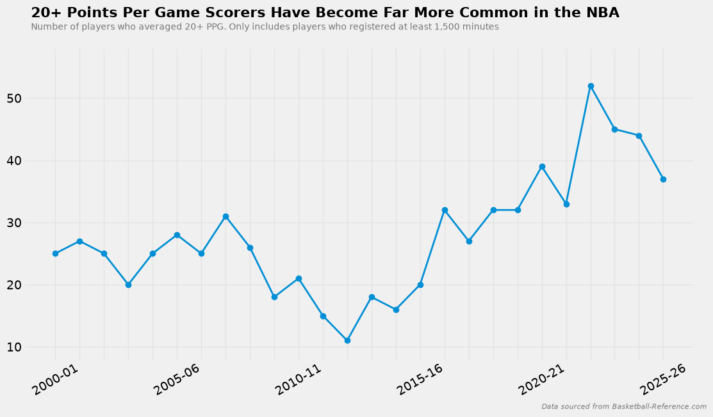
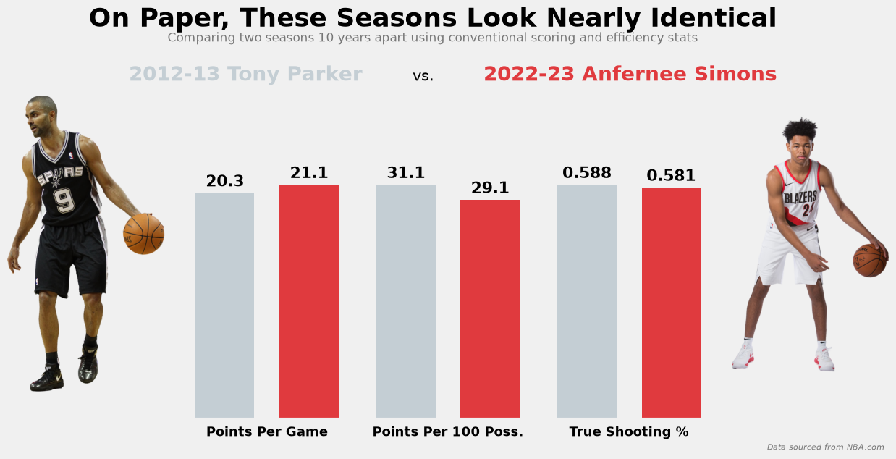
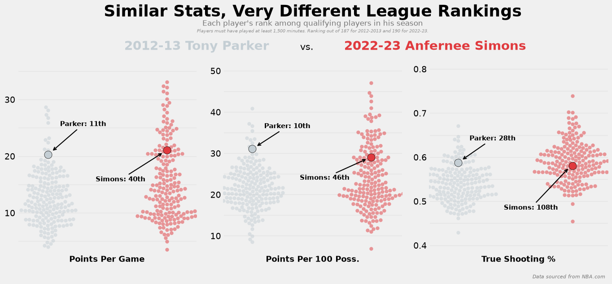
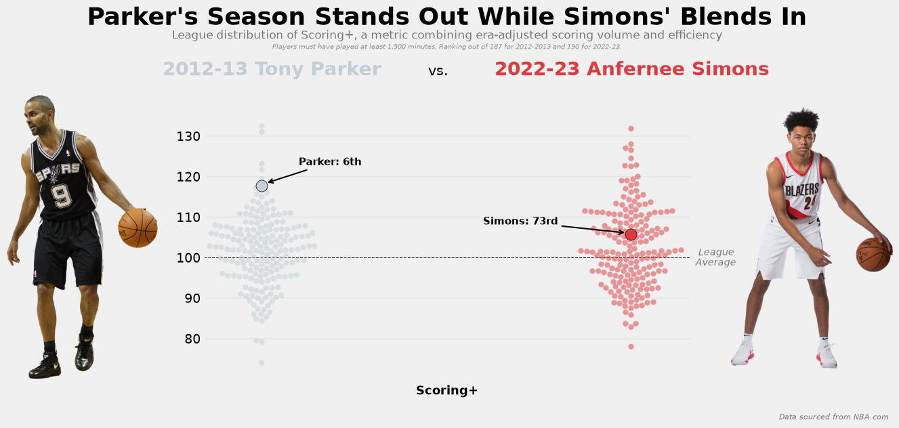
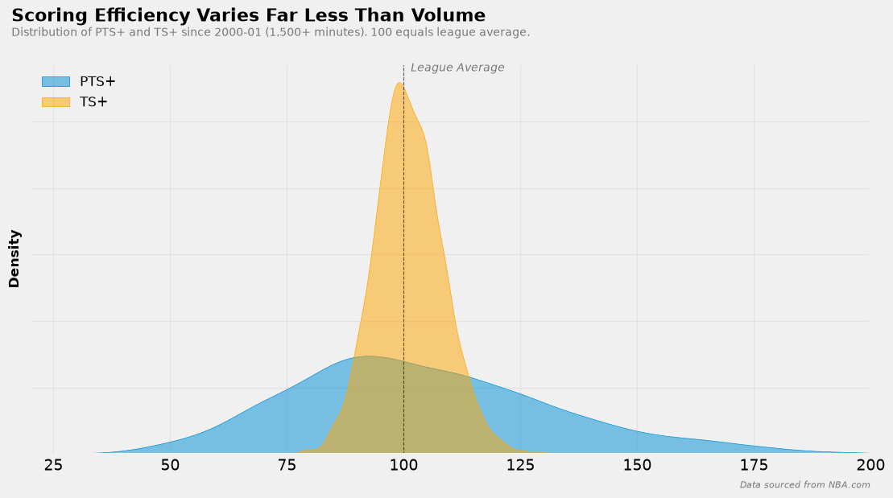
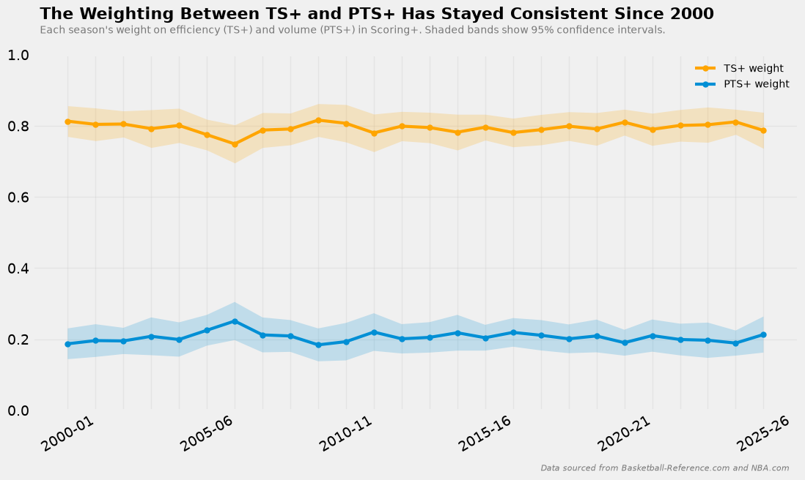

<h1 align="center">Scoring+ Methodology</h1>

## Introduction

Baseball has never grabbed me the way the other sports do, it has its moments but I watch fewer than 5 complete games a year. I still enjoy casually following it, though, and that is made simpler because of how easy it is to quantify most of the game. This makes it easy for someone like me to just take a look at some leaderboards and get a good understanding of who is playing well and who is having an off year. Obviously, stats can't capture everything, but for a casual follower they do a lot of the work.

My favorite baseball statistics are the era- and ballpark-adjusted ones, such as ERA+ and OPS+. If you're not familiar with them, they take a classic statistic like ERA, which measures a pitcher's earned runs per nine innings, and add context by comparing it to that season's league average and adjusting for ballpark conditions. A pitcher from the steroid era, for example, gets more grace for a high ERA than one from the dead-ball era. These stats are always indexed so that 100 is league average, which makes it easy to tell whether a player was above or below average for his era.

Basketball, on the other hand, is one of my favorite sports to actually watch. It provides constant scoring and entertainment throughout a game. For plenty of fans, though, basketball is what baseball is to me, something they are a casual follower of. Basketball is not a sport that is as easily quantified and measured with statistics like baseball can be. To get a real understanding of players and teams, you actually have to watch and analyze the games. Despite that, analytics have become a much larger part of the NBA in recent years, but there is still plenty of debate over which stats matter and which are biased one way or another, which makes it more complex to follow.

A bigger problem for casual fans, and even for many people who follow the league closely, is the inflation of offensive numbers over the past decade and how that affects how we view these stats. Teams have embraced analytics, built rosters and schemes around the three-point line, and pushed league-wide scoring to historic levels. As a result, we hear about a historic scoring season every year, and comparing a scoring season from today with one from even 10 years ago has become genuinely difficult. The clearest sign of this is how common 20-point scorers have become. In 2012-13, only 11 players averaged 20 or more points per game (minimum 1,500 minutes). By 2022-23, that number had climbed to 52.

Raw scoring has also grown faster than efficiency. Since the 2000-01 season, league points per game has risen about 22%, while offensive rating (points per 100 possessions) has risen about 13%. Part of this scoring boom is pace, and part of it is genuinely better offense, which means raw numbers from different seasons are not measured on the same scale.

### A Tale of Two Guards

To help illustrate this problem, I want to look at Tony Parker's 2012-13 season and Anfernee Simons' 2022-23 season. These two seasons happened a decade apart, Parker's at the low point of 20-point scorers and Simons' at the high point. Now, if you were to look at their conventional scoring stats without that context, you would see two almost identical scoring seasons.

While scoring isn't the only factor in accolades, it would be considered the strength of each of these guards, and each of these respective seasons was received very differently in that regard. In the 2012-13 season, Parker finished 6th in MVP voting, made an All-NBA Second Team and the All-Star team. He also was the leading scorer on a Spurs team that finished with the 3rd best record, the 7th ranked offense and was one Ray Allen shot away from being champions. Simons on the other hand collected no accolades and was a second or third option on a bottom-five Trail Blazers Team that finished 17th in offensive rating.

This gap can be explained by taking a look at league rankings in each of their respective years. Among qualifying players, Parker ranked 11th in points per game, 10th in points per 100 possessions, and 28th in true shooting percentage. Simons ranked 40th, 46th and 108th in the same categories. Parker was an elite scorer in a low-scoring league while Simons was a solid to good scorer in the highest-scoring league in decades.

This is the inspiration for creating a basketball stat that is comparable to the ERA+ or OPS+ of baseball, one that recognizes that there is context behind the conventional stats on a page. A player in today's NBA shouldn't be graded on the same curve as a player from 10 or 20 years ago when it was a completely different league. Scoring+ is my attempt at a solution for the fan who just wants to know who the better scorer was: their favorite player today, or their older brother's favorite player from 2012. It's built into Baseline, where you'll find it next to every player's season stats.

## What is Scoring+?

Scoring+ is a single number that summarizes a player's scoring season relative to the league he played in, allowing for direct comparisons between different seasons with a level playing field. It combines two era-adjusted versions of familiar, conventional stats in PTS+, a measure of scoring volume using points per 100 possessions, and TS+, which measures scoring efficiency using true shooting percentage. The goal of this stat is to balance the scoring volume and efficiency of a player to create a resulting statistic that represents how effective a scorer was compared to his peers.

Scoring+ is also a rate stat at its core. Because both components are measured per possession or per shot, a player isn't rewarded simply for playing more minutes or possessions than someone else. To keep small samples from producing extreme values, the analysis is limited to players with at least 1,500 minutes, as is standard for most NBA rate stats.

Like ERA+ and OPS+, Scoring+ is centered on 100, which always represents the league average for that given season. A player with a Scoring+ above 100 is considered an above-average scorer, while one below 100 is a below-average one. A Scoring+ of 115, for example, means a player's scoring was roughly 15% better than the league-average scorer once volume and efficiency are both accounted for.

Unlike ERA+ and OPS+, Scoring+ adjusts for era only and not for physical environment, since every NBA court has the same dimensions and conditions unlike baseball.

**The Formula:**

$$
\text{Scoring}^{+} = 100 + 0.205\,(\text{PTS}^{+} - 100) + 0.795\,(\text{TS}^{+} - 100)
$$

The next two sections will define PTS+ and TS+ further, and the section after that explains where the 0.205 and 0.795 weights come from.

Back to our earlier comparison between Parker and Simons, these new statistics show the true separation between these seasons that looked identical on the surface. Parker posts a Scoring+ of 118, ranking 6th in the 2012-13 season, along with a PTS+ of 148 and TS+ of 110. Simons had a less impressive looking Scoring+ of 106, ranking 73rd in 2022-23, with a PTS+ of 128 and TS+ of 100.

This demonstrates the exact kind of comparison that Scoring+ was built for. Previously, understanding the separation between Parker's and Simons' seasons took a full breakdown using raw stats, league rankings in three categories and the scoring environment of each season. Scoring+ does all of that work in a single number. A 118 against a 106 tells you right away that Parker was the more effective scorer relative to the league he played in, without needing to know what the league-wide pace was, what stage of the three-point revolution the NBA was in or how many 20-point scorers the league had in each season. Like the baseball equivalents of ERA+ and OPS+, it doesn't tell the full story of a player, but it gives any fan a quick, era-adjusted something to point to when trying to decide on who the better scorer really was.

## PTS+

Efficiency alone doesn't make someone a great scorer. A player who only takes a few easy but high percentage shots a game, like open corner threes or lobs off a pick and roll, can post an excellent true shooting percentage without carrying much of the offense load. Without a volume component of Scoring+, these low-volume, high-efficiency players would rank above the stars who take the hardest shots and carry the biggest scoring burden, and that is not what I want this stat to represent. Including the volume component ensures that Scoring+ rewards players who take on a bigger role in the offense when they're on the court and score more.

PTS+ is that part of the Scoring+ formula that measures a player's scoring volume, relative to the league. The process of choosing the right volume stat was more difficult than it sounds on the surface. A simple points per game was ruled out early because it depends heavily on minutes played, and finding a league average with this stat would lead to high-minute outliers pulling it in either direction.

Instead, I decided to use points per 100 possessions to build PTS+. As a rate stat, it controls for both a player's time on the court as well as the pace of the league in that season. The league average is calculated by taking the league-average team's points per 100 possessions, also known as offensive rating, and dividing that number by 5, since a team always has five players on the floor at once. This gives the scoring rate per 100 possessions of a theoretical average player in a league that season.

**The Formula:**

$$
\text{PTS}^{+} = \frac{\text{Player points per 100 possessions}}{\text{League average points per 100 possessions}} \times 100
$$

A PTS+ of 148, like Parker's, means that he scored at a rate 48% higher than the average player on the floor that season.

## TS+

Volume scoring alone doesn't make a player a great scorer, either. A player who chucks up shots whenever they're on the floor can put up a lot of points, even when many of these shots are missed, but every missed shot is a possession his team didn't get any points on (looking at you Antoine Walker). If Scoring+ measured volume only, the same issue that was mentioned above would arise where these types of players would be rewarded over players who pass up on the bad shots for more efficient ones. Including an efficiency stat makes sure Scoring+ rewards players who score a lot and do it without wasting their team's possessions.

TS+ is the efficiency component and measures a player's scoring efficiency relative to his league, using true shooting percentage (TS%). I did not invent TS+ as sites like Basketball-Reference already publish it on their website, but I do believe that it is a great statistic to use for this purpose. TS% is widely regarded as the best single measure of scoring efficiency because it accounts for the extra value of three-pointers and folds in free throw shooting, rather than treating every shot the same.

**TS% Formula:**

$$
\text{TS\%} = \frac{\text{PTS}}{2\,(\text{FGA} + 0.44 \times \text{FTA})}
$$

- **PTS:** Total Points
- **FGA:** Field Goal Attempts
- **FTA:** Free Throw Attempts
- **0.44:** An estimate of the possessions used per free throw attempt, since and-ones, technicals and three-shot fouls mean not every pair of free throws ends a possession

TS+ then indexes a players TS% to the league average like PTS+:

$$
\text{TS}^{+} = \frac{\text{Player TS\%}}{\text{League Average TS\%}} \times 100
$$

A TS+ of 100, like Simons', means he was an exact league-average shooter that year in efficiency terms. His .581 TS% looks strong in isolation, but in the efficiency and analytic driven league of 2022-23, he was simply average.

## Weighting

Scoring+ weights efficiency (TS+) at 0.795 and volume (PTS+) at 0.205. These weights were not chosen by hand but instead were estimated using historical data. This section explains why a simple assumption of a 50/50 split is statistically naive, how the weights were derived, and then how they were validated.

### Why not assume 50/50?

There are two problems that come up when weighting PTS+ and TS+ equally.

1. **Volume and efficiency overlap.** A player's points per 100 possessions is mathematically the product of how often he shoots and efficiently he converts, meaning efficiency is already partly baked into PTS+. Any weight then placed on PTS+ carries some efficiency along with it, which makes the most accurate balance hard to judge simply by using intuition.
2. **The distribution of PTS+ and TS+ are not the same.** Both of these stats are indexed to 100, but TS% is much more tightly clustered among players with real minutes while scoring volume varies widely depending on a player's role. Therefore, the standard deviation of PTS+ is much larger than that of TS+, so in a raw average PTS+ would dominate the result purely through arithmetic.

Neither problem means volume and efficiency should matter unequally, they just indicate the right balance can't simply be assumed. The weighting has to be estimated and on a scale that accounts for each stat's spread. As the regressions in the below sections show, the data does end up giving the two components nearly equal influence once their distributions are taken into account. A raw 50/50 average of PTS+ and TS+ would not be accurate due to PTS+'s wider spread letting it dominate the output.

### Letting the Data Choose the Weights

Rather than deciding for myself which component matters more based on arbitrary conceptions of importance, I let the data estimate how much each one contributes to a player's offensive impact. This follows the logic of another baseball stat, wOBA, which uses historical run values from thousands of games to decide how much a walk is worth relative to a double or a home run.

To measure offensive impact, I used two offense-only rate metrics that are already standard in basketball analytics. Using two targets instead of one keeps the weights from inheriting the quirks of any single formula, since each metric's biases partly offset the other's.

- **Offensive Box Plus/Minus (OBPM):** this is the offensive half of Box Plus/Minus (BPM), which uses only traditional box score data to estimate a player's contribution per 100 possessions while he is on the court, relative to an average player. For more details, refer to [About Box Plus/Minus (BPM)](https://www.basketball-reference.com/about/bpm2.html) from Basketball-Reference.
- **Offensive Win Shares per 48 minutes (OWS/48):** Dean Oliver's adaptation of Bill James' baseball Win Shares, which estimates how many of a team's wins came from a player's offense. The Win Shares stat is built so that a team's players sum to roughly its actual win total. OWS/48 is the per-minute rate version of the offensive half of the stat. For more details, refer to [NBA Win Shares](https://www.basketball-reference.com/about/ws.html) from Basketball-Reference.

Both of these are rate stats, which make them compatible with Scoring+, TS+ and PTS+, which are also rate stats. Using a counting stat as the target would make minutes played a confounding variable in the regression.

### Checking for Multicollinearity

Before running the regressions, I checked whether PTS+ and TS+ were too correlated to separate. As mentioned before, PTS+ already has efficiency baked into it in a way so this was a valid concern for my model. After converting both to z-scores, the variance inflation factor (VIF) was about 1.07. A VIF of 1 means no correlation at all between predictors, and values below 5 are generally considered safe, so multicollinearity is not a concern here at all. The overlap between volume and efficiency flagged earlier is real, but it is small enough for the regressions to separate the two cleanly.

### The Regressions

I ran two ordinary least squares (OLS) regressions, one predicting OBPM and one predicting OWS/48, each using the z-scores of PTS+ and TS+ as predictors. The targets were also converted to z-scores so that their different scales would not affect the coefficients. I then averaged the standardized coefficients from the two models, converted them back to the original PTS+ and TS+ scales by dividing each by its predictor's standard deviation, and normalized them to sum to 1, which produced the final weights of 0.795 for TS+ and 0.205 for PTS+.

Because these weights are on the raw scale, they also absorb the difference in spread between the two components. PTS+ has a standard deviation of 28.58 and TS+ has 7.35. A one standard deviation change therefore moves Scoring+ by about 5.86 points through PTS+ (0.205 × 28.58) and about 5.84 points through TS+ (0.795 × 7.35).

In other words, averaged across these two targets, the historical data says volume and efficiency matter almost exactly equally in terms of offensive impact while nothing in the method forced that result. The OBPM and OWS/48 metrics are built from two different formulas in two completely different ways, with OBPM built from a regression model using box-score stats similar to mine and OWS using allocations of a known total. The regressions were free to land on any split between the two components and the near-perfect balance is simply how the numbers fell.

That balance is not a flaw or a hidden assumption in the formula, it is the data's own answer to what makes a scorer effective. The larger TS+ weight does not mean efficiency matters four times as much; it compensates for how tightly TS+ is clustered, so that a typical swing in efficiency and a typical swing in volume move Scoring+ by about the same amount.

| | OBPM Model | OWS/48 Model | Average |
| --- | --- | --- | --- |
| PTS+ coefficient (z) | 0.6969 | 0.3420 | 0.51944 |
| TS+ coefficient (z) | 0.3491 | 0.6898 | 0.51945 |
| R² | 0.736 | 0.718 | N/A |

The sample covers every season from 2000-01 through 2025-26, limited to players with at least 1,500 minutes (n=4865 player-seasons).

### Validation

To confirm the results of my model, I tested it on data it had not seen in two ways:

1. **Time-based split.** I trained the model on seasons from the 2000-01 season through 2019-20 and tested on the most recent seasons until 2025-26, roughly an 80/20 split. This checks whether weights learned from older seasons still hold up today in the modern NBA or if there is a significant difference.
2. **K-fold cross validation.** A single training/testing split can be lucky or unlucky depending on which seasons end up in a given test set. To guard against that situation, I randomly divided the seasons into five groups, or "folds", then trained on four of these folds and tested on the fifth, repeating this process until every fold had been used as the test set once. This maintained the same 80/20 split used in the previous time-based split. I then averaged the five runs, giving us a more reliable result than a single split.

| | Full Model (Reference) | Time-Based Split | K-Fold (Mean ± SD) |
| --- | --- | --- | --- |
| OBPM R² (Training) | 0.736 | 0.722 | 0.742 ± 0.007 |
| OBPM R² (Testing) | N/A | 0.787 | 0.739 ± 0.029 |
| OWS/48 R² (Training) | 0.718 | 0.722 | 0.717 ± 0.001 |
| OWS/48 R² (Testing) | N/A | 0.701 | 0.716 ± 0.005 |
| TS+ Weight | 0.795 | 0.794 | 0.794 ± 0.002 |
| PTS+ Weight | 0.205 | 0.206 | 0.206 ± 0.002 |

The results from both of these splits show no sign of overfitting our model. An overfit model would fit the training data well but drops off noticeably on data it hasn't yet seen. Here, the model performs about as well on our testing seasons as on the ones it learned from. Across the five folds, test R² averaged 0.739 for OBPM and 0.716 for OWS/48, nearly identical to the respective training R² of 0.742 and 0.717. The small standard deviations also show that those results held up no matter which seasons were held out.

The time-based split then provides a tougher test, since the model was trained only on seasons before 2020-21 and then applied to the most recent, three-point heavy, seasons. The model was also able to hold up there too. OWS/48 test R² of 0.701 was only slightly below the training's 0.722, and the R² for OBPM actually increased in testing from 0.722 to 0.787. To clarify, this increase of R² doesn't mean the model got better, R² can rise when the test seasons simply have a wider range of OBPM values. The key point being that the performance of the models held steady on seasons that the model hadn't seen before, whereas a model that was overfit would have shown a clear drop off.

The most important result, the weighting of TS+ and PTS+, barely moved between tests. Both of these methods produced a TS+ weight of 0.794 and a PTS+ of 0.206, which are both within 0.001 of the full model weights. The k-fold weights only varied slightly across all five models with a standard deviation of 0.002, showing steadiness even within the random samples. This testing shows that the weights for Scoring+ formula are not an artifact of which seasons happened to be in the sample because the data lands on the same balance every time.

### Stability Across Seasons

The validation tests that I conducted above have already shown that the weights hold up across different groupings of seasons, but there is the possibility that it may have missed some trends and a gradual shift between eras. So as a final check, I estimated the weights separately for each season and plotted them to create a visualization that shows whether their balance between efficiency and volume has shifted as the league changed.

As you can see above, there isn't an obvious shift or trend that was missed. The TS+ weight stays near 0.8 and PTS+ near 0.2 in every season since 2000-01, and each season's estimate falls within the 95% confidence interval of the others. This means that a single set of weights can be applied to every season without adjusting by year.

## Conclusion

Scoring+ is a statistic that I built to answer a simple question: how can you compare a player's scoring performance today with a player in any other given era or season? What I created was a stat that combines scoring volume, in the form of PTS+, and scoring efficiency, in the form of TS+, into one era-adjusted number with an easily digestible scale. The balance between volume and efficiency wasn't set by my own judgment or intuition, but instead from 26 seasons of data that landed on a nearly equal influence between the two. That balance held up across multiple methods of extensive testing, through both random and time-based splits. The result of this is a stat is able to differentiate between two players who might look to have identical conventional scoring numbers. With the added context of the league they played in, a real gap can appear, best demonstrated by the comparison made earlier between Tony Parker and Anfernee Simons.

Like those baseball statistics I drew inspiration from, Scoring+ is a quick snapshot and first look, not the whole story of a player. It doesn't account for shot difficulty, or whether the player created the shot or was set up by his teammates. Those details are covered in deeper profiles elsewhere in the app. It also only measures scoring, not taking into account any other part of a players offensive game like playmaking or rebounding, or any defensive impact a player brings to the floor, and therefore should not be extrapolated to represent anything besides a player's scoring. Its weights were fitted to OBPM and OWS/48, which are both built from box score data and may share some of the same blind spots. Currently, the data only covers the regular seasons from 2000-01 onward, and uses players with at least 1,500 minutes for any calculations conducted.

Scoring+ gives fans what ERA+ and OPS+ have long given baseball fans, a quick and context-backed way to compare their favorite player today with the guy their older brother won't shut up about.
